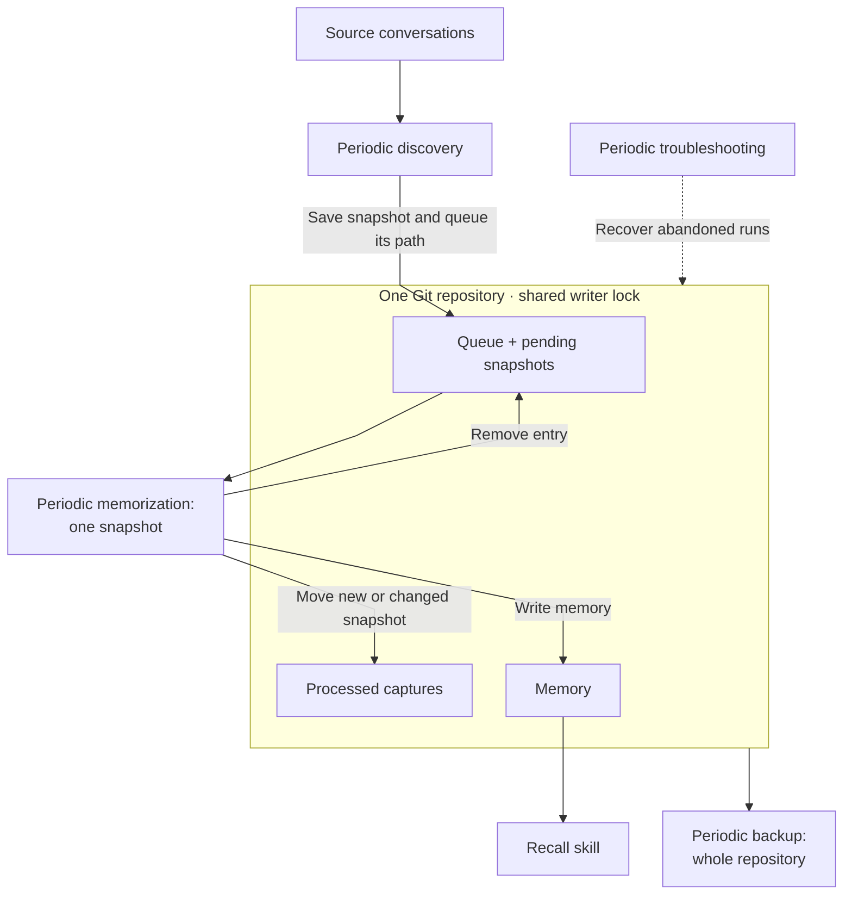

# Memory Flow

Discovery saves immutable conversation snapshots and queues their paths in one commit. Memorization processes the oldest queued snapshot, moves it to processed captures, updates memory, and removes its queue entry in one commit. If its content matches the latest processed capture, it deletes the pending snapshot and removes the queue entry instead. Both acquire the shared lock before changing the repository.
