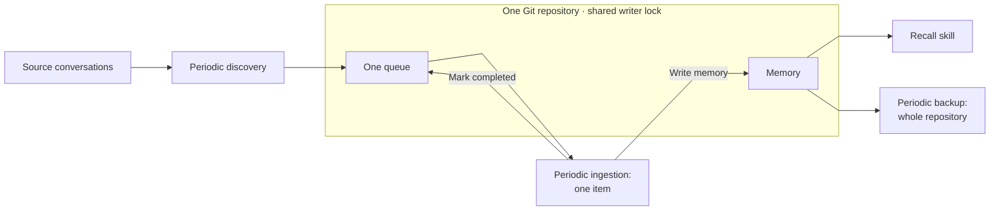

# Memory Flow

Discovery queues conversations for ingestion of their latest available content. Ingestion writes memory and marks the item completed in one commit. Both acquire the shared lock before changing the repository.
